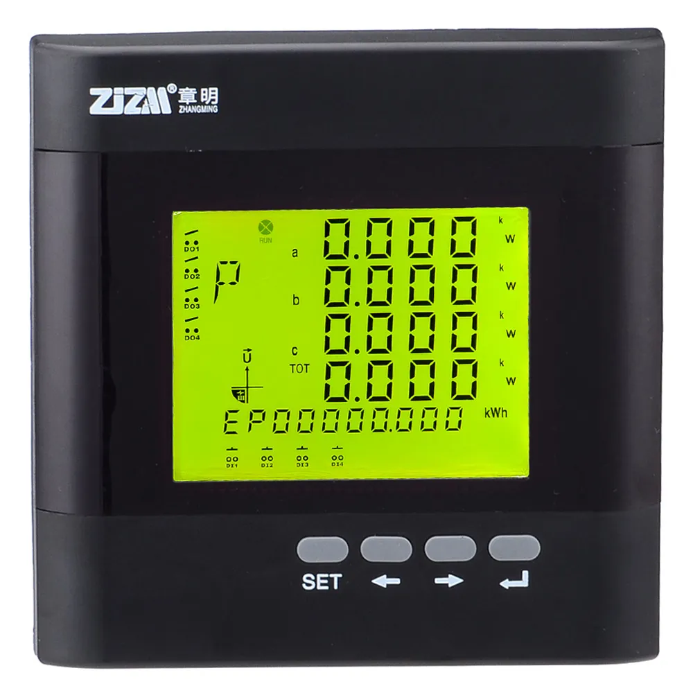
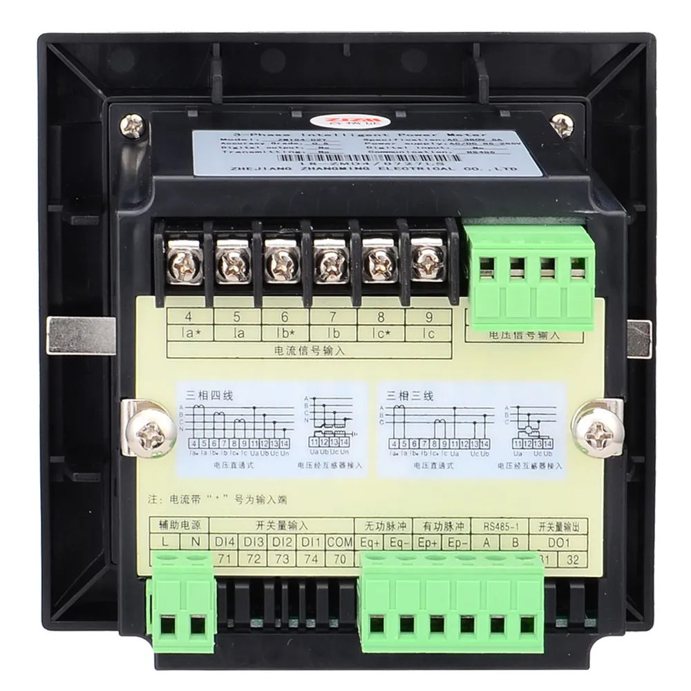

# ZM194-DAY Multifunction Digital Network Meter — User Manual (English translation)

*Translated from the original China manufacturer's manual (Zhejiang Zhangming Electrical Co., Ltd.). Product standard:
GB/T 22264.7-2008. Machine-assisted translation reviewed against the source.*

| Front panel | Terminal layout |
|---|---|
|  |  |

---

## Contents

1. Technical specifications
   1.1 Nameplate data
2. Installation and wiring
   2.1 Dimensions
   2.2 Wiring diagram
3. Programming
4. Front panel and displayed quantities
   4.1 LCD display 96×96, 120×120
   4.2 LCD display 72×72, 80×80
   4.3 Screen sequence (LCD indicator)
   4.4 Screen sequence (digital indicator)
5. Communication protocol
6. Typical faults and remedies
   6.1 Communication problems
   6.2 Inaccuracy of U, I, P and other measurements

---

## 1. Technical specifications

| Parameter | Value |
|---|---|
| Input signals — wiring scheme | Three-phase four-wire / three-phase three-wire |
| Voltage — range | 380 V / 100 V |
| Voltage — overload | Continuous: 1.2×; short-term: 2× |
| Voltage — burden | < 1 VA |
| Current — range | 5 A / 1 A |
| Current — overload | Continuous: 1.2×; short-term: 2× |
| Current — burden | < 1 VA |
| Frequency | 45…65 Hz |
| Supply | AC/DC 85…265 V or AC 220 V, < 5 VA |
| Energy pulses | Optocoupler open-collector output, potential-free; fixed pulse width 72 ms ± 20 % |
| Communication | RS-485, galvanically isolated physical layer; MODBUS-RTU protocol; 2400 / 4800 / 9600 baud |
| Analogue output | Conditioned output 4…20 mA or 0…5/10 V; the transmitted quantity and its full-scale value are programmable |
| Relay output | Programmable relay output for remote control / alarm; switching capacity 5 A at 250 V AC, 5 A at 30 V DC; the monitored quantity (alarm) or control mode is set in software |
| Digital inputs | State of digital inputs measured; potential-free ("dry contact") input; mapping to an alarm relay output is programmable |
| Accuracy class | Measured quantities: 0.5S; frequency: ± 0.2 Hz; active energy: class 1.0; reactive energy: class 2.0 |
| Display | Dedicated indicator panel / LCD |
| Environment | Operating temperature −10…+55 °C; storage −20…+75 °C; relative humidity < 80 % RH |
| Safety | Insulation resistance of signal, supply and output circuits vs. enclosure > 5 MΩ; dielectric strength signal/supply/output vs. enclosure > 2 kV AC |

### 1.1 Nameplate data

| Field | Value |
|---|---|
| Product name | Three-phase intelligent electricity meter |
| Model | ZM194-DAY |
| Ratings | AC 380 V, 5 A |
| Accuracy class | 0.5 |
| Supply | AC/DC 85…265 V |
| Digital outputs / inputs / analogue output | none |
| Communication interface | RS-485 |
| Enclosure colour | black |
| Order code | 23-ZMD4/0109LS |
| Manufacturer | Zhejiang Zhangming Electrical Co., Ltd. |

---

## 2. Installation and wiring

### 2.1 Dimensions

Panel-cut dimensions (mm):

| Case size (L × H) | Panel cut-out (A × B) | Window (S × Y) | Total depth (N) | Depth (M) |
|---|---|---|---|---|
| 80 × 80 | 75 × 75 | 76 × 76 | 93 | 78 |
| 72 × 72 | 67 × 67 | 68 × 68 | 93 | 78 |

### 2.2 Wiring

#### 2.2.1 Low-voltage connection (basic function)

Basic measurements + digital inputs + digital outputs · conditioned analogue output.

Notes:

1. Terminals 1 and 2 are the meter's auxiliary power supply. Make sure the
   supply matches the meter's rated version to avoid damage.
2. Terminals marked with an asterisk (\*) are the **input (line-side) terminals
   of the current circuits**.
3. Three-phase three-wire connection: in such a network the phase-B current is
   not connected, and voltage U_B is applied to terminal 14.
4. See the wiring diagram printed on the specific unit's enclosure for the
   exact terminal assignment.

#### 2.2.2 Connecting the input signals

Connection variants: three-phase four-wire — direct and via transformers;
three-phase three-wire; two-CT (two-transformer) connection.

1. **Voltage input.** The applied voltage must not exceed the meter's rated
   input voltage (100 V or 400 V); otherwise use a voltage transformer (VT/PT).
   A terminal block is recommended for serviceability.
2. **Current input.** Nominal input current is 5 A; for larger currents use
   external current transformers (CTs). If other instruments share the same
   CTs, connect them in series. Before disconnecting wires from the meter's
   current inputs, always open the CT primary circuit or short-circuit the
   secondary. A terminal block is recommended.
3. **Phasing.** Voltage and current must correspond phase-to-phase, with the
   same phase sequence and the same direction. Violations cause errors in
   value and sign — first of all in power and energy.
4. The meter operates in three-phase four-wire or three-phase three-wire
   systems; choose according to the actual installation. Usually three-wire
   when there is no neutral, four-wire when there is. A three-wire scheme
   needs two CTs (phases A and C); a four-wire scheme needs three CTs (with
   only two CTs the third phase current may be computed synthetically).

**Attention!** The meter can be configured for either wiring scheme; the
configured scheme must match the actual wiring, otherwise readings will be
wrong.

The actual wiring scheme, pulse constant and other parameters are given on
the wiring diagram shipped with the unit.

---

## 3. Programming

In programming mode the display is a multi-level menu shown on three lines:
line 1 — first-level menu, line 2 — second level, line 3 — third level.
Example: level 1 `InPr` (input signals), level 2 `ICt` (current transformer
ratio), level 3 value `5`, i.e. a setting of 5 corresponds to a CT of 25/5 A = 5.

Operating instructions:

1. After changing a value/option in the third-level menu, press `↵` to return
   to the second level — only then the change takes effect.
2. The wiring scheme can be changed to match the actual installation.
3. Type and factory settings are usually printed on the rear label; the user
   can reprogram the meter if needed.
4. To edit a number, increase/decrease digits with `◀`/`▶`; `SET` moves
   between digit positions.
5. While editing `PT`, `CT`, `UAL` and similar parameters, pressing `◀` and
   `▶` simultaneously selects the number of decimal places.
6. Pressing `↵` cycles through the energy display screens.

Menu structure — enter by holding `SET` for 3 s; access code `0001`.

| Level 1 | Level 2 | Level 3 | Explanation |
|---|---|---|---|
| `SET` (system settings) | `dISP` | `SET → dISP → U` | `Auto` — automatic cyclic display; U, I, P, Q, PF … Auto. E.g. U — phase voltage, UL — line-to-line voltage |
| | `dISL` | `SET → dISL → 0001` | 0000–9999 — LCD backlight timeout |
| | `CLrE` | `SET → CLrE → 1111` | 1111 — reset accumulated energy |
| `InPr` (input signals) | `nEr` | `InPr → nEr → 3-4` | 3-4 — three-phase four-wire; 3-3 — three-phase three-wire |
| | `UPt` | `InPr → UPt → 001.0` | VT ratio range 1–9999. Press `◀`+`▶` together to set decimal places. The CT ratio and suppression thresholds are set the same way (not repeated below) |
| | `ICt` | `InPr → ICt → 001.0` | CT ratio range 1–9999 |
| | `U-0` | `InPr → U-0 → 0015` | Voltage suppression threshold range 0–9999 |
| | `I-0` | `InPr → I-0 → 0015` | Current suppression threshold range 0–9999 |
| | `Con1 → Sn` | `Con1 → Sn → 0001` | Device address on the network, 1–247 |
| | `Con1 → bAUd` | `Con1 → bAUd → 9600` | Three baud rates: 2400; 4800; 9600 |
| | `SET → do-0` | `SET → do-0 → 000d` | Alarm chain setting: with TYPE = 0001 output do-1 may drive do-0; with TYPE = 1000 output do-4 may drive do-0 |
| | `do-0 → TYPE` | `do-0 → TYPE → 1110` | 1● — normally-open output, closes on alarm; 2● — normally-closed, opens on alarm; 3PuS — pulse mode alarm |
| | `do-1 → TYPE` | `do-1 → TYPE → 129` | Select the alarm quantity (see note 3 of the protocol section). TYPE = 129 — phase-A voltage overvoltage alarm |
| | `do-1 → VAL` | `do-1 → VAL → 5.000` | Alarm setpoint value |
| | `do-1 → dLY` | `do-1 → dLY → 00` | Alarm time delay |
| | | | (digital outputs: the other three channels are set the same way) |
| | `Ao-1 → TYPE` | `Ao-1 → TYPE → 129` | Select the transmitted quantity (see note 3). TYPE = 129 — transmit phase-A voltage |
| | `Ao-1 → 0220` | `Ao-1 → 0220` | Value corresponding to the end of the transmission range |
| | | | (analogue outputs: the other three channels are set the same way) |

---

## 4. Front panel and displayed quantities

The front panel has a multi-digit display and four keys (`SET`, `◀`, `▶`, `↵`)
for switching screens, viewing measurements and programming. Display symbol
meanings are in the table below; example screens in sections 4.3 and 4.4.

### 4.1 LCD display 96×96, 120×120

Four digit rows show: three-phase voltage; three-phase current; active and
reactive power, power factor; frequency; digital input/output states; import
active energy and reactive energy in both directions; analogue inputs.
Keys: `◀`/`▶` — page switching or value change; `SET` — enter programming;
`↵` — select/confirm.

`K` — thousands, `M` — millions: magnitude indicators. If `K` is lit, the real
value is 1000× the displayed one; if `M` — 1,000,000×.

Unit markings: three-phase voltage — V; three-phase current — A; active
power — W; reactive power — var; power factor — dimensionless; frequency — Hz;
plus digital output/input icons.

### 4.2 LCD display 72×72, 80×80

Same as 4.1, for the smaller display size.

### LCD symbols

| # | Symbol | Meaning |
|---|---|---|
| 1 | Five-row digital display | First four rows: measured quantities (voltage, current, power, PF, frequency, …); fifth row: accumulated energy |
| 2 | ab, bc, ca, Σ, TOT, AVG | a/b/c — phase A/B/C; ab/bc/ca — line-to-line voltage Uab/Ubc/Uca; Σ — total; TOT — total; AVG — average |
| 3 | Units kVA MW Mvar MVA MWh Mvarh Hz PF % | current A/kA; voltage V/kV; active power W/kW/MW; reactive power var/kvar/Mvar; apparent power VA/kVA/MVA; active energy kWh/MWh; reactive energy kvarh/Mvarh; frequency Hz; percentage % |
| 4 | Energy direction / quadrant | 14 — import active + forward reactive (quadrant 1); 23 — reverse active + forward reactive (quadrant 2); 12 — reverse active + reverse reactive (quadrant 3); 34 — import active + reverse reactive (quadrant 4) |
| 5 | RUN | Operation indicator |
| 6 | ALARM | Alarm state |
| 7 | COM1 / COM2 | Communication channel 1 / 2 activity |
| 8 | DO1…DO4 | State of the four digital outputs |
| 9 | DI1…DI4 | State of the four digital inputs |
| 10/11 | open/closed contact icons | contact open / closed |

### 4.3 Screen sequence (LCD indicator)

- Ia, Ib, Ic, average current, total import active energy
- frequency, voltage unbalance, current unbalance, total reactive energy
- Ua, Ub, Uc, average voltage, reverse-direction energy
- PFa, PFb, PFc, total PF, import active energy
- Pa, Pb, Pc, total active power, import reactive energy
- Qa, Qb, Qc, total reactive power
- Va, Vb, Vc, total apparent power, reverse reactive energy

### 4.4 Screen sequence (digital indicator)

- Phase voltages: Ua, Ub, Uc and average (four-wire); `K` → kV
- Line-to-line voltage (`V` blinking; `K` → kV)
- Active/reactive power and PF: rows A/B/C show total active power, total
  reactive power and power factor; `K` → kW
- Total active energy: rows 2+3 form an 8-digit value (e.g. 789.889 kWh)
- Reverse active energy (e.g. 456.566 kWh)
- Import active energy (e.g. 13,652.009 kWh)
- Total reactive energy (e.g. 0.012 kvarh)
- Reverse reactive energy (e.g. 0.000 kvarh)
- Import reactive energy (e.g. 0.012 kvarh)
- Phase voltages with `K` → kV; currents with `K` → kA

---

## 5. Communication protocol

The meter uses international Modbus-RTU over a half-duplex RS-485 line.
Read function code: **0x03**. Write function code: **0x10**. Checksum: CRC-16;
on a checksum error the meter returns nothing. Frame format n81 (8 data bits,
no parity, 1 stop bit).

Error handling: on an error the high bit of the function code is set (e.g. a
request with function 0x04 gets response 0x84). Error codes:

- `0x01` illegal function — the meter does not support the received function;
- `0x02` illegal data address — requested address outside the meter's range;
- `0x03` illegal data value — written value outside the permitted range.

### 1. Reading a group of registers

Example: read phase voltage Ua. Address `0x0000`, 4 bytes = 2 registers,
coefficient 0.001.

Request: `01 03 00 00 00 02 C4 0B`
Response: `01 03 04 00 03 5B 30 31 17`

Actual value = raw × 0.001. Raw `00035B30` = 219952 → **219.952 V**.

### 2. Writing a group of registers

Example: write the PT ratio (value 100). PT register `0x0039`, 4 bytes.
Write value 100 × 1000 = 100000 = `0x000186A0`:

Request: `01 10 00 39 00 02 04 00 01 86 A0 03 xx`

### Register map — settings/measurement data

| # | Addr | Variable | Default | Len | Range | Access | Coeff. |
|---|---|---|---|---|---|---|---|
| 1 | 0x0000 | Phase voltage Ua | 0.000 | 2 | 0…9999 | R | 0.001 |
| 2 | 0x0002 | Phase voltage Ub | 0.000 | 2 | 0…9999 | R | 0.001 |
| 3 | 0x0004 | Phase voltage Uc | 0.000 | 2 | 0…9999 | R | 0.001 |
| 4 | 0x0006 | Line voltage Uab | 0.000 | 2 | 0…9999 | R | 0.001 |
| 5 | 0x0008 | Line voltage Ubc | 0.000 | 2 | 0…9999 | R | 0.001 |
| 6 | 0x000A | Line voltage Uca | 0.000 | 2 | 0…9999 | R | 0.001 |
| 7 | 0x000C | Current Ia | 0.000 | 2 | 0…9999 | R | 0.001 |
| 8 | 0x000E | Current Ib | 0.000 | 2 | 0…9999 | R | 0.001 |
| 9 | 0x0010 | Current Ic | 0.000 | 2 | 0…9999 | R | 0.001 |
| 10 | 0x0012 | Active power phase A, Pa | 0.000 | 2 | 0.000…9999 | R | 1 |
| 11 | 0x0014 | Active power phase B, Pb | 0.000 | 2 | 0.000…9999 | R | 1 |
| 12 | 0x0016 | Active power phase C, Pc | 0.000 | 2 | 0.000…9999 | R | 1 |
| 13 | 0x0018 | Total active power Ps | 0.000 | 2 | 0.000…9999 | R | 1 |
| 14 | 0x001A | Reactive power phase A, Qa | 0.000 | 2 | 0.000…9999 | R | 1 |
| 15 | 0x001C | Reactive power phase B, Qb | 0.000 | 2 | 0.000…9999 | R | 1 |
| 16 | 0x001E | Reactive power phase C, Qc | 0.000 | 2 | 0.000…9999 | R | 1 |
| 17 | 0x0020 | Total reactive power Qs | 0.000 | 2 | 0.000…9999 | R | 1 |
| 18 | 0x0022 | Power factor PFa | 0.000 | 2 | 0…1.0 | R | 0.001 |
| 19 | 0x0024 | Power factor PFb | 0.000 | 2 | 0…1.0 | R | 0.001 |
| 20 | 0x0026 | Power factor PFc | 0.000 | 2 | 0…1.0 | R | 0.001 |
| 21 | 0x0028 | Total power factor PFs | 0.000 | 2 | 0…1.0 | R | 0.001 |
| 22 | 0x002A | Apparent power phase A, VAa | 0.000 | 2 | 0.000…9999 | R | 1 |
| 23 | 0x002C | Apparent power phase B, VAb | 0.000 | 2 | 0.000…9999 | R | 1 |
| 24 | 0x002E | Apparent power phase C, VAc | 0.000 | 2 | 0.000…9999 | R | 1 |
| 25 | 0x0030 | Total apparent power VAs | 0.000 | 2 | 0.000…9999 | R | 1 |
| 26 | 0x0032 | Frequency | 0.000 | 2 | 0.0…500 | R | 0.001 |
| 27 | 0x0034 | Voltage unbalance | 0.000 | 2 | 0.000…9999 | R | 0.001 |
| 28 | 0x0036 | Current unbalance | 0.000 | 2 | 0.000…9999 | R | 0.001 |
| 29 | 0x0038 | Total active energy | 0.000 | 2 | 0.00 kWh…99.99999 MWh | R | 1 |
| 30 | 0x003A | Import (forward) active energy | 0.000 | 2 | 0.00 kWh…99.99999 MWh | R | 1 |
| 31 | 0x003C | Reverse active energy | 0.000 | 2 | 0.00 kWh…99.99999 MWh | R | 1 |
| 32 | 0x003E | Total reactive energy | 0.000 | 2 | 0.00 kvarh…99.999999 Mvarh | R | 1 |
| 33 | 0x0040 | Import (forward) reactive energy | 0.000 | 2 | 0.00…99.999999 | R | 1 |
| 34 | 0x0042 | Reverse reactive energy | 0.000 | 2 | 0.00…99.999999 | R | 1 |
| 35 | 0x0044 | Wiring scheme Link | 0 | 1 | 0…1 | R/W | 1 (note 1) |
| 36 | 0x0045 | VT ratio PT | 1000 | 2 | 1000…9999000 | R/W | 0.001 |
| 37 | 0x0047 | CT ratio CT | 1000 | 2 | 1000…9999000 | R/W | 0.001 |
| 38 | 0x0049 | Device address Add | 1 | 1 | 0…255 | R/W | 1 |
| 39 | 0x004A | Baud rate bAUd | 1 | 1 | 0…2 | R/W | 1 (note 2) |
| 40 | 0x004B | Device address Add2 | 1 | 1 | 0…255 | R/W | 1 |
| 41 | 0x004C | Baud rate bAUd2 | 1 | 1 | 0…2 | R/W | 1 (note 2) |
| 42 | 0x004D | Alarm delay, channel 1 | 0 | 1 | 0…60 | R/W | 1 |
| 43 | 0x004E | Alarm mode, channel 1 | 0 | 1 | 0…29 | R/W | 1 (note 3) |
| 44 | 0x004F | Alarm setpoint AL1, channel 1 | 1000 | 2 | −1999000…9999000 | R/W | 0.001 |
| 45–53 | 0x0051…0x005B | Alarm channels 2–4 (same layout) | | | | R/W | |
| 54–61 | 0x005D…0x0067 | Analogue transmission channels 1–4 (mode + value) | | | | R/W | 0.001 (note 3) |
| 62 | 0x0069 | Digital output state DO | 0x0000 | 1 | 0…0xFFFF | R | 1 (note 4) |
| 63 | 0x006A | Digital input state DI | 0x0000 | 1 | 0…0xFFFF | R | 1 (note 5) |
| 64 | 0x006B | Device identifier | 0x0A01 | 1 | 0x0000…0xFFFF | R | 1 |
| 65 | 0x006C…0x006F | Relay control 1…4 | 0x0000 | 1 | write 0xAAAA = engage, 0x5555 = release (when alarm mode 29) | W | 1 |

**Note 1 — wiring scheme:** exchanged value `0x34 0x33` ↔ menu 3-4;
`0x00 0x01` ↔ menu 3-3.

**Note 2 — baud rate:** exchanged `0x2400` / `0x4800` / `0x9600` (or `0x00` /
`0x01` / `0x02`) ↔ 2400 / 4800 / 9600.

**Note 3 — quantity codes for alarms (low/high limit) and 4…20 mA
transmission:** 1 = Ua, 2 = Ub, 3 = Uc, 4 = Uab, 5 = Ubc, 6 = Uca, 7 = Ia,
8 = Ib, 9 = Ic, 10 = Pa, 11 = Pb, 12 = Pc, 13 = Ps, 14 = Qa, 15 = Qb, 16 = Qc,
17 = Qs, 18 = PFa, 19 = PFb, 20 = PFc, 21 = PFs, 22 = Va, 23 = Vb, 24 = Vc,
25 = Vs, 26 = frequency; 29 = relay output controlled via comms; transmission
codes = quantity + 128.

**Note 4 — DO state (0x0069):** bits D0…D3 = alarm relays 1…4 (1 = relay
engaged).

**Note 5 — DI state (0x006A):** bits D0…D3 = digital inputs 1…4 (1 = closed).

---

## 6. Typical faults and remedies

### 6.1 Communication problems

1. **No data returned.** First verify that the meter's communication
   parameters (slave address, baud rate, parity/checksum) match the master's.
2. **Other communication issues.** This series uses half-duplex
   request-response. If the meter returns data at all, an RS-485 hardware
   fault is nearly excluded. Re-check the communication settings and the data
   conversion method described in the protocol section; usually this is enough.

### 6.2 Inaccuracy of U, I, P and other measurements

First verify the correct signals are present: check voltage with a multimeter,
and current with a clamp meter if needed. Then check the wiring: in particular
the **corresponding (line-side) terminals of the current circuits** and the
phase sequence. Errors there produce wrong value **and sign** of power.

Active power on the display is normally positive; it becomes negative only on
reverse power flow. If active power is negative, the CT line/load terminals
are probably swapped; wrong phase sequence also causes abnormal power
readings.

Note: the display shows values referred to the primary side. If the PT/CT
ratios configured in the meter do not match the actual transformers, energy
readings will be wrong. The internal voltage/current ranges cannot be changed
after manufacture.

The field wiring may follow the actual scheme, but the wiring scheme set in
the programming menu must match the physical wiring — otherwise indications
are wrong.
